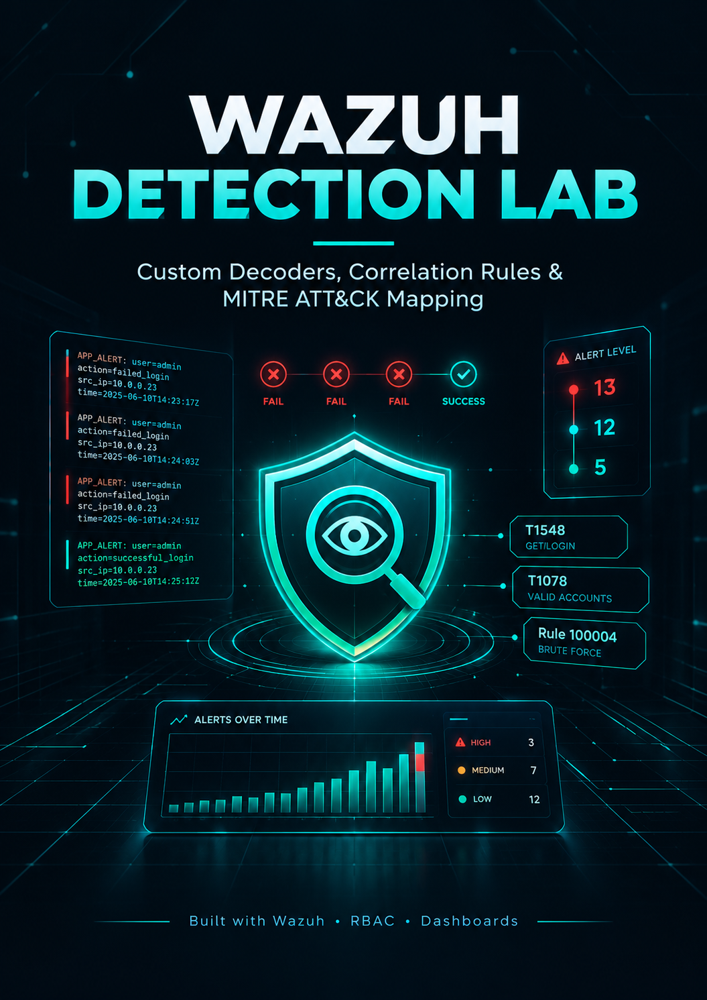

# Wazuh Detection Lab

A hands-on cybersecurity lab focused on detecting suspicious login activity using Wazuh.

### Overview
- Custom decoders and correlation rules
- Detection of failed and successful login patterns
- MITRE ATT&CK mapping
- Wazuh alerts and dashboards

### Tools
- Wazuh SIEM
- Custom XML rules and decoders
- MITRE ATT&CK

### Key Learning
Turning raw authentication logs into meaningful security alerts for investigation.

**Author:** Sidra Bibi
